<picture><source media="(prefers-color-scheme: dark)" srcset="./assets/hero-dark.png">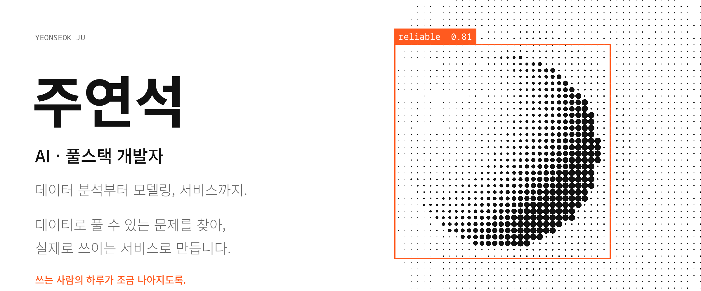</picture>

<a href="https://pollux-o4.github.io/itIsMe/"><picture><source media="(prefers-color-scheme: dark)" srcset="./assets/profile-portfolio-dark.svg"></picture></a>&emsp;&emsp;<a href="https://www.linkedin.com/in/yeonseok-ju-37b2b7370/"><picture><source media="(prefers-color-scheme: dark)" srcset="./assets/profile-linkedin-dark.svg"></picture></a>

 

<picture><source media="(prefers-color-scheme: dark)" srcset="./assets/journey-dark.svg">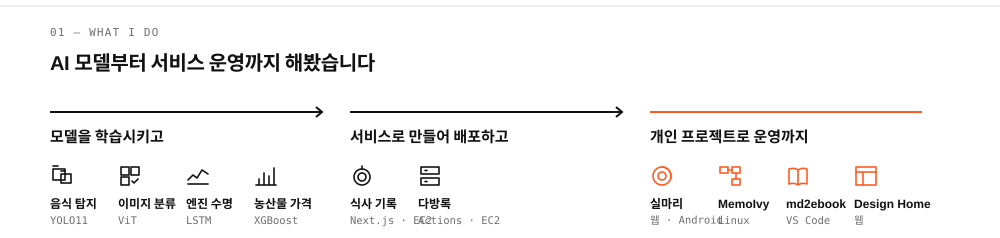</picture>

 

<picture><source media="(prefers-color-scheme: dark)" srcset="./assets/timeline-dark.png">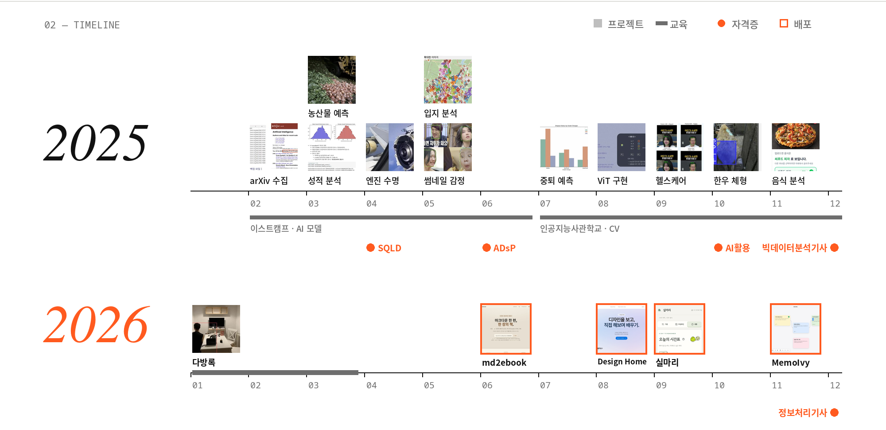</picture>

<picture><source media="(prefers-color-scheme: dark)" srcset="./assets/stack-dark.svg">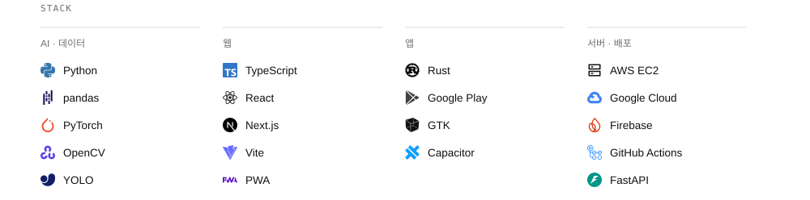</picture>

 

<picture><source media="(prefers-color-scheme: dark)" srcset="./assets/head-03-dark.svg"></picture>

<a href="https://youtube.com/shorts/7hj92GtiodM">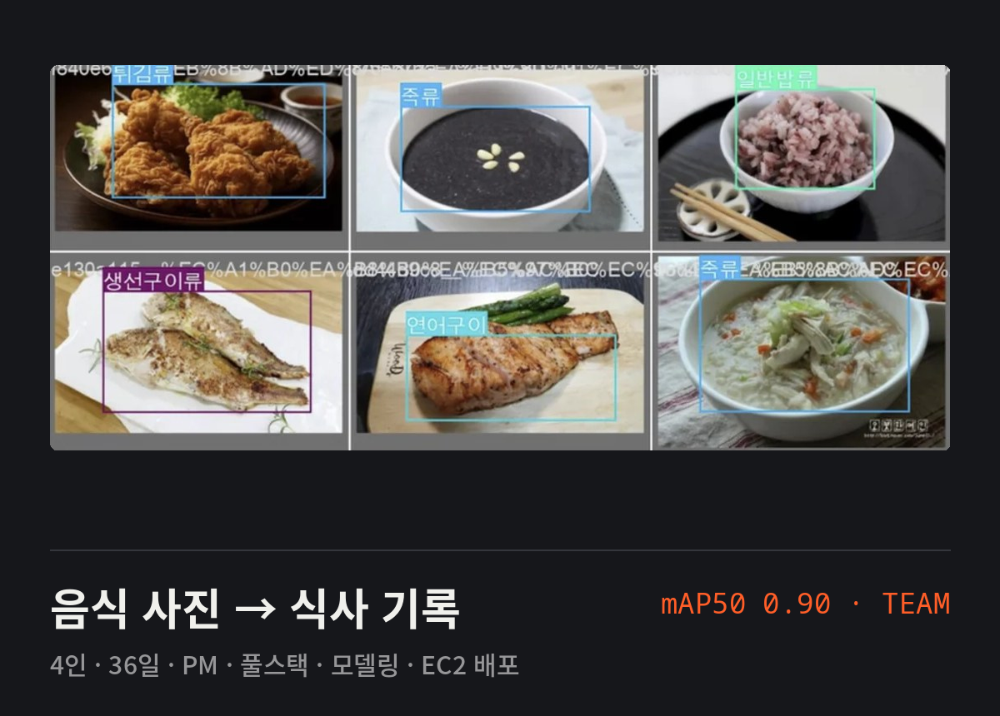</a>&nbsp;<a href="https://github.com/pollux-o4/Agri-Price-Forecast">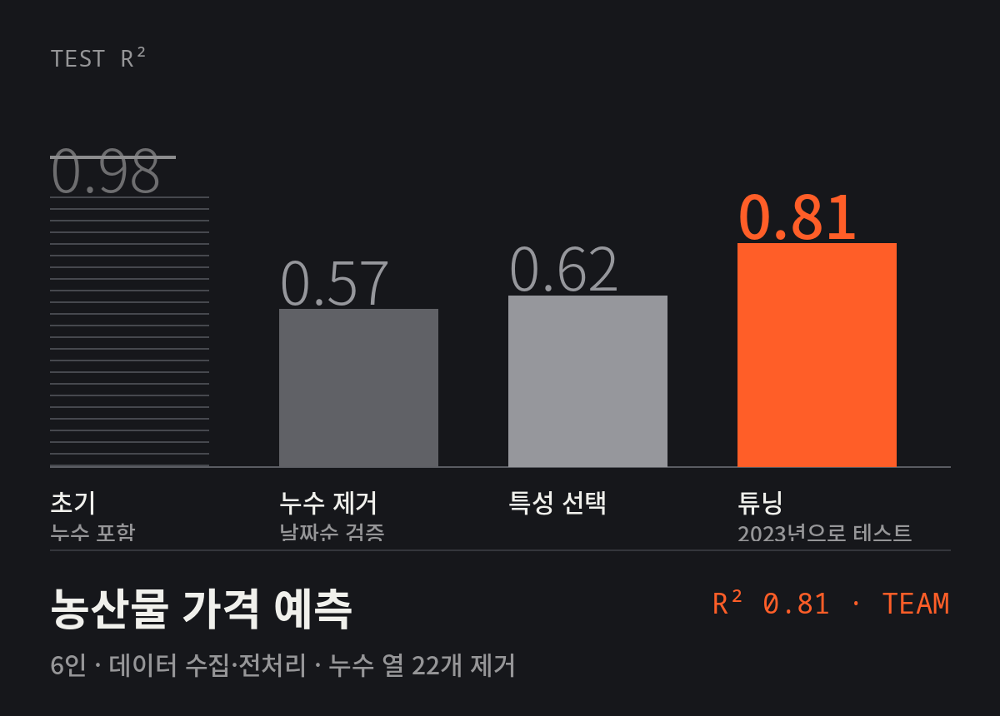</a> &nbsp;

 

<picture><source media="(prefers-color-scheme: dark)" srcset="./assets/head-04-dark.svg"></picture>

<a href="https://silmari-todo.web.app/app/">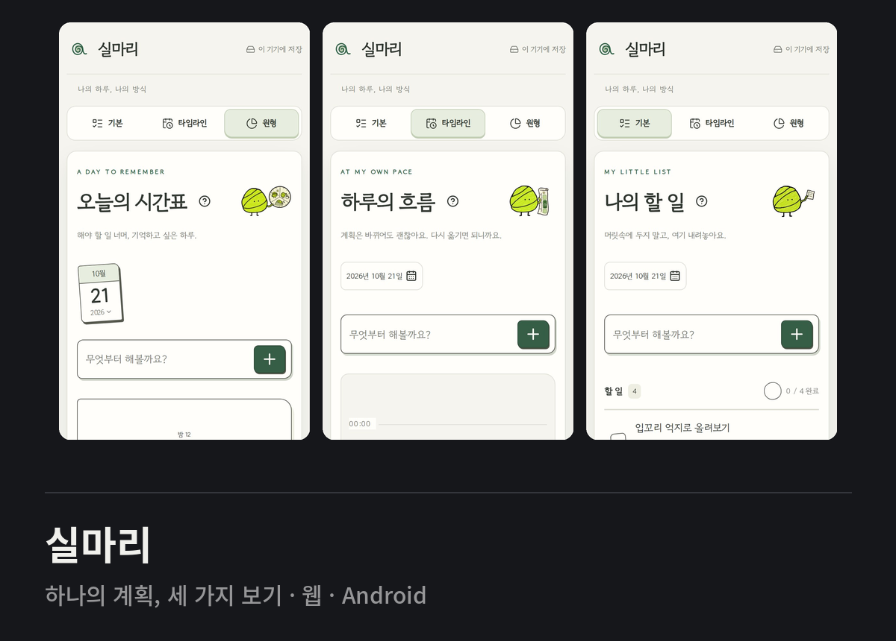</a>&nbsp;<a href="https://snapcraft.io/memoivy">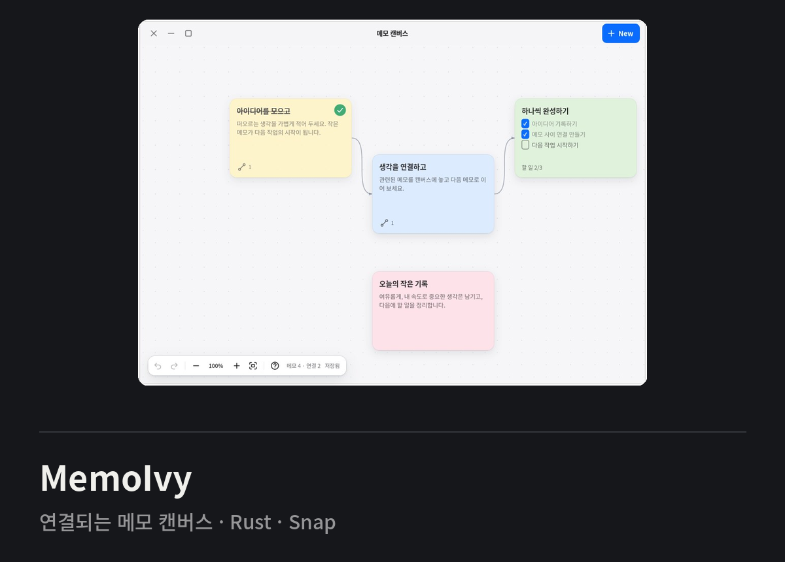</a> &nbsp;

<a href="https://marketplace.visualstudio.com/items?itemName=pollux-o4.markdown-ebook-reader">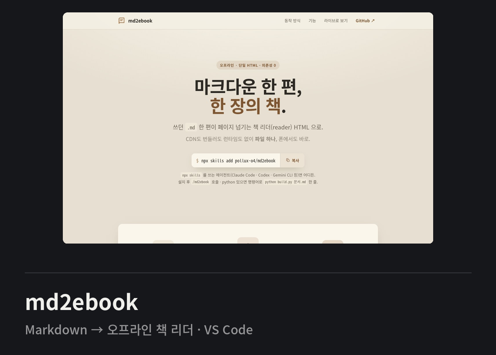</a>&nbsp;<a href="https://pollux-o4.github.io/design-home/">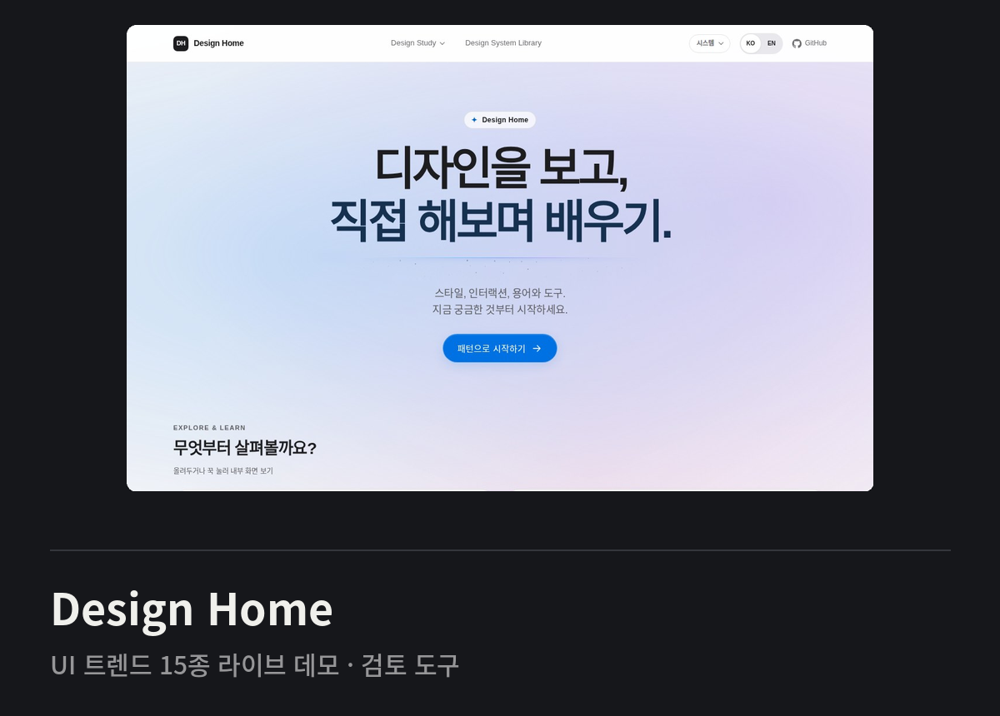</a> &nbsp;

 

<picture><source media="(prefers-color-scheme: dark)" srcset="./assets/contrib-dark.svg">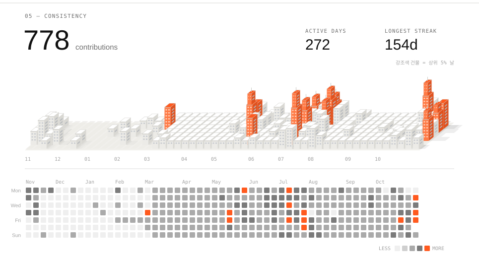</picture>

 

<a href="mailto:yeonseok.ju@gmail.com"><picture><source media="(prefers-color-scheme: dark)" srcset="./assets/contact-dark.png">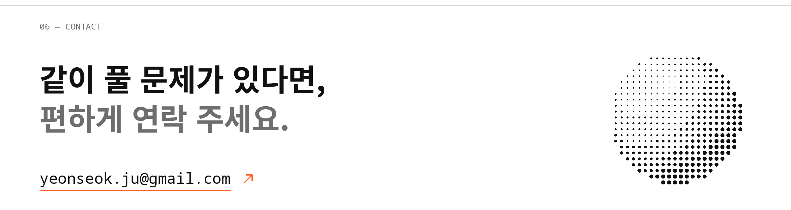</picture></a>
